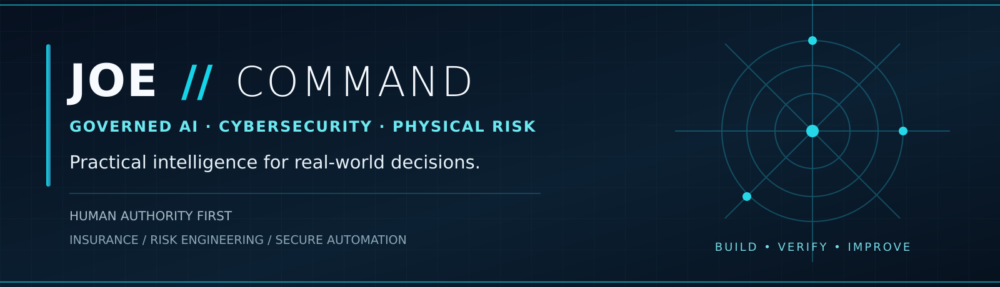
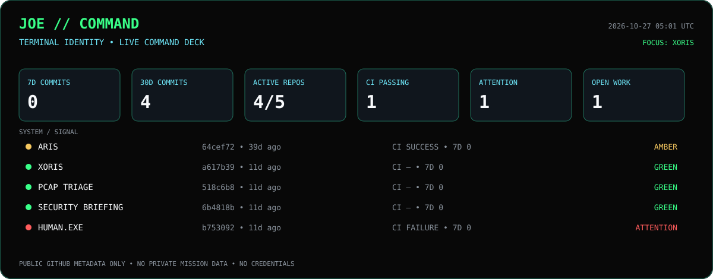
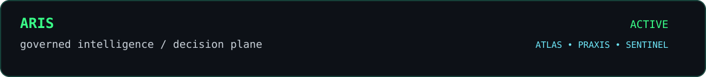
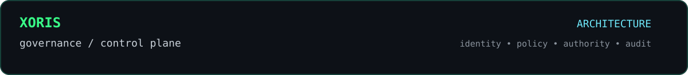
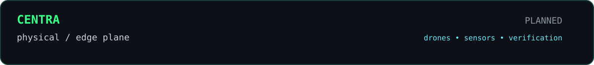
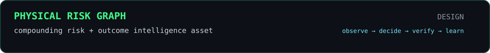

<p align="center">
  
</p>

> **Building governed intelligence infrastructure for the physical world — systems that help humans and machines observe, reason, decide, act, verify, and learn.**

```text
joe@command:~$ identity --public

name         Joe Murillo
role         Insurance + AI Systems Builder
focus        Agentic AI / Cybersecurity / Insurance / Physical Risk
building     ARIS / XORIS / CENTRA / Physical Risk Graph
industry     Commercial Insurance / Loss Control / Risk Engineering
employer     Pennsylvania Lumbermens Mutual
region       Southern California, USA
protocol     OBSERVE → ANALYZE → MODEL → DECIDE → ACT → VERIFY
status       ALWAYS BUILDING
```

---

## `joe@command:~$ whoami --impact`

**Insurance domain expertise × secure AI engineering × physical-world intelligence.**

I build practical, human-governed intelligence systems informed by commercial insurance, loss control, business development, and cybersecurity. My focus is translating operational risk into auditable software: clear authority, explicit limits, useful evidence, and measurable outcomes.

**Explore the work first:**

| Project | What it demonstrates | Current public status |
| --- | --- | --- |
| [ARIS](https://github.com/joemurillo-ai/aris) | Mission lifecycle, agent authorization, governance history, and security-first AI orchestration | Active research and development; public repository may lag local work |
| [Azure AI Security Briefing Agent](https://github.com/joemurillo-ai/azure-ai-security-briefing-agent) | Translating cloud security signals into decision-ready briefings | Export-first MVP; live integrations planned |
| [PCAP Triage Pipeline](https://github.com/joemurillo-ai/pcap-triage-pipeline) | Network evidence extraction and structured investigation reporting | Demonstration / learning project |
| [XORIS](https://github.com/joemurillo-ai/xoris-ai) | Product positioning and a web interface for commercial growth intelligence | Landing-page implementation; not a deployed AI control plane |

**Engineering approach:** human authority before agent autonomy · least privilege · explicit failure states · reproducible tests · honest maturity labels.

**Important boundary:** Architecture diagrams express design direction, not proof that all components are deployed, integrated, or operational. Experimental execution controls are not production security guarantees.

---

## `joe@command:~$ cat architecture.sys`

```text
JOE
└── XORIS  ── governance / control plane
    └── ARIS ── intelligence / decision plane
        ├── ATLAS     establish what is true
        ├── PRAXIS    plan what should be done
        └── SENTINEL  challenge assumptions / confidence / security
            └── CENTRA ── physical / edge plane
                └── PHYSICAL RISK GRAPH
```

**Target architecture:** XORIS is envisioned as the governance/control plane; ARIS as the intelligence/decision plane; CENTRA as the physical/edge plane; and the Physical Risk Graph as a longer-term evidence asset. These are distinct stages of development, not a claim of end-to-end deployment.

---

## `joe@command:~$ dashboard --details`

<details>
<summary><strong>Expand the command-center visual</strong> — portfolio telemetry and system status are shown below</summary>

<p align="center">
  
</p>

</details>

---

## `joe@command:~$ pulse --portfolio`

<!-- V5:PULSE:START -->
```text
PORTFOLIO PULSE
----------------------------------------------------------------
commits_7d           4
commits_30d          4
active_repos_30d     4/5
ci_success           1
attention_signals    1
open_prs             1
open_issues          0
focus_repo           XORIS
```
<!-- V5:PULSE:END -->

---

## `joe@command:~$ trust --surface`

Operational signal only — **not a security rating**. It combines public commit recency, CI state, and visible work pressure.

<!-- V5:TRUST:START -->
| System | Activity | CI | Work pressure | Operational signal |
|---|---|---|---|---|
| ARIS | WARM | SUCCESS | CLEAR | AMBER |
| XORIS | ACTIVE | — | CLEAR | GREEN |
| PCAP TRIAGE | ACTIVE | — | CLEAR | GREEN |
| SECURITY BRIEFING | ACTIVE | — | CLEAR | GREEN |
| HUMAN.EXE | ATTENTION | FAILURE | LIGHT | ATTENTION |
<!-- V5:TRUST:END -->

---

## `joe@command:~$ queue --public`

Public execution queue derived from open pull requests and issues across the tracked portfolio.

<!-- V5:QUEUE:START -->
| Type | System | Work item |
|---|---|---|
| PR | `humanexe` | #1 Fix HUMAN.EXE waitlist false-positive signups (review only) |
<!-- V5:QUEUE:END -->

---

## `joe@command:~$ telemetry --live`

Regenerated automatically from **public GitHub metadata** every six hours.

<!-- V5:TELEMETRY:START -->
| System | Branch | Head | Last commit | 7d | 30d | PRs | Issues | Latest Action | Signal |
|---|---|---:|---:|---:|---:|---:|---:|---|---|
| ARIS | `main` | `64cef72` | 34d ago | 0 | 0 | 0 | 0 | SUCCESS | WARM |
| XORIS | `master` | `a617b39` | 6d ago | 1 | 1 | 0 | 0 | — | ACTIVE |
| PCAP TRIAGE | `main` | `518c6b8` | 6d ago | 1 | 1 | 0 | 0 | — | ACTIVE |
| SECURITY BRIEFING | `main` | `6b4818b` | 6d ago | 1 | 1 | 0 | 0 | — | ACTIVE |
| HUMAN.EXE | `main` | `b753092` | 6d ago | 1 | 1 | 1 | 0 | FAILURE | ATTENTION |

`telemetry_sync: 2026-10-22 17:09 UTC`  
`boundary: public GitHub metadata only`
<!-- V5:TELEMETRY:END -->

---

## `joe@command:~$ tail -n 12 mission.log`

<!-- V5:MISSION_LOG:START -->
| UTC | System | Mission event | Commit |
|---|---|---|---|
| 2026-10-15 22:18 | `humanexe` | docs(humanexe): disclose waitlist persistence gap and release gates | `b753092` |
| 2026-10-15 22:17 | `xoris-ai` | docs(xoris): clarify prototype scope and reproducibility | `a617b39` |
| 2026-10-15 22:12 | `azure-ai-security-briefing-agent` | docs(security-briefing): distinguish MVP from planned cloud integrations | `6b4818b` |
| 2026-10-15 22:12 | `pcap-triage-pipeline` | docs(pcap): clarify triage workflow, limitations and safe evidence hand… | `518c6b8` |
| 2026-09-17 21:02 | `aris` | Merge pull request #12 from joemurillo-ai/chore/reconcile-persisted-exe… | `64cef72` |
| 2026-09-17 21:00 | `aris` | chore: reconcile persisted execution roadmap | `181cff9` |
| 2026-09-17 20:41 | `aris` | Merge pull request #11 from joemurillo-ai/agent/persisted-execution | `b6a884f` |
| 2026-09-17 20:37 | `aris` | feat: execute persisted missions | `cc83931` |
| 2026-09-17 20:06 | `aris` | Merge pull request #10 from joemurillo-ai/chore/reconcile-agent-authori… | `48491a5` |
| 2026-09-17 20:04 | `aris` | chore: reconcile agent authorization roadmap | `6398090` |
| 2026-09-17 03:25 | `aris` | feat: enforce mission agent authorization (#9) | `c8144e9` |
| 2026-09-17 02:59 | `aris` | chore: reconcile governance events roadmap status (#8) | `5b38a76` |
<!-- V5:MISSION_LOG:END -->

---

## `joe@command:~$ show_nodes --fabric`

```text
NODE 01  SENTINEL   Linux / Omarchy          ACTIVE
         └─ security • infrastructure • SSH • Tailscale

NODE 02  WINDOWS    Microsoft / Enterprise   ACTIVE
         └─ GitHub • VS Code • Copilot • Power Platform • Azure

NODE 03  macOS      Apple dev cockpit        PLANNED
NODE 04  ATLAS      AI / GPU compute         PLANNED
NODE 05  VAULT      storage / artifacts      PLANNED
NODE 06  CENTRA     physical / edge          PLANNED
NODE 07  MOBILE     iPhone / iPad ops        ACTIVE
NODE 08  LAB        adversarial sandbox      PLANNED
```

---

## `joe@command:~$ ls ./systems`

<a href="https://github.com/joemurillo-ai/aris"></a>

<a href="https://github.com/joemurillo-ai/xoris-ai"></a>





### `joe@command:~$ ls ./spotlight`

<a href="https://github.com/joemurillo-ai/aris"></a>  `governed mission execution • lifecycle • authorization • audit`

<a href="https://github.com/joemurillo-ai/xoris-ai"></a>  `governance • control plane • identity • policy`

<a href="https://github.com/joemurillo-ai/pcap-triage-pipeline"></a>  `network evidence → analysis → incident-ready reporting`

<a href="https://github.com/joemurillo-ai/azure-ai-security-briefing-agent"></a>  `AI-powered security briefing workflows`

<a href="https://github.com/joemurillo-ai/humanexe"></a>  `human execution and workflow experiments`

---

## `joe@command:~$ cat doctrine.txt`

```text
01  BUILD DIGITAL TWINS OF FUNCTIONS — NOT DIGITAL TWINS OF PEOPLE.
02  HUMAN AUTHORITY > AGENT AUTHORITY.
03  NO AUTONOMY WITHOUT IDENTITY, POLICY, AUTHORIZATION,
    OBSERVABILITY, AUDIT, AND REVERSIBILITY.
04  HARDWARE IS REPLACEABLE.
05  MODELS ARE REPLACEABLE.
06  THE DRONE IS A SENSOR. THE MODEL IS A PERCEPTION LAYER.
07  VERIFIED OUTCOME DATA COMPOUNDS.
```

---

## `joe@command:~$ contact --show`

```text
GitHub     github.com/joemurillo-ai
LinkedIn   linkedin.com/in/joemurillo
Email      info@joemurillo.com
```

<p align="center">
  <sub>JOE // COMMAND • secure AI • real-world risk • evidence before claims</sub>
</p>
